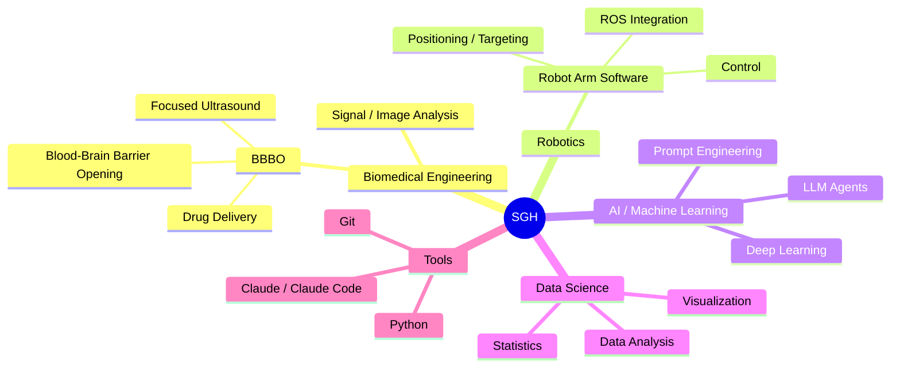
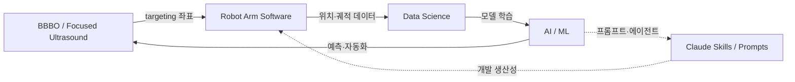

[README.md](https://github.com/user-attachments/files/31406391/README.md)
<!--
  ┌─────────────────────────────────────────────────────────────┐
  │  이 파일을 그대로 GitHub 프로필 README로 쓰는 방법            │
  │                                                             │
  │  1) GitHub에서 저장소 이름을 "ahnsihyun1222" 로 새로 생성     │
  │     (⚠ 프로필 README는 저장소 이름 = GitHub ID 여야만 동작!) │
  │     (Public 체크 + "Add a README file" 체크)                │
  │  2) 이 파일 내용을 그 저장소의 README.md 에 붙여넣기          │
  │                                                             │
  │  ※ 화면에 보이는 이름(Syun)은 자유롭게 바꿔도 됩니다.        │
  └─────────────────────────────────────────────────────────────┘
-->

<h1 align="center">Hi there 👋 I'm Syun</h1>

  <b>Biomedical Engineer · AI/ML Researcher · Robotics Software</b> 
  Kyung Hee University · Focused Ultrasound (BBBO) × Robot Arm × Machine Learning

  

---

## 🧑‍🔬 About Me

- 🔬 **연구 분야**: Biomedical Engineering — 특히 **BBBO(Blood-Brain Barrier Opening)** 및 Focused Ultrasound
- 🤖 **개발 분야**: **Robot Arm Software Engineering** (로봇 팔 제어/포지셔닝 소프트웨어)
- 🧠 **관심 분야**: AI / Machine Learning, Data Science & 분석
- 🐍 **주력 언어**: Python (데이터 · AI 중심)
- 🎓 **소속**: Kyung Hee University
- 📫 **Contact**: khs12220610@khu.ac.kr

---

## 🛠️ Tech Stack

**Languages & Core**

**AI / Data**

**Robotics & Tools**

<!-- 사용하지 않는 배지는 지우고, 필요한 건 https://shields.io 에서 추가하세요 -->

---

## 🗺️ Research & Development Map

> 나와 관련된 연구·개발 정보들의 전체 매핑입니다. (GitHub는 Mermaid 다이어그램을 자동 렌더링합니다)

🔗 연구 ↔ 개발 연결 관계 (클릭해서 펼치기)

---

## 🚀 Projects

<!-- 아래를 실제 프로젝트로 교체하세요. 각 저장소 링크를 걸면 좋아요. -->

| Project | Description | Stack |
|---|---|---|
| 🧠 **BBBO Research** | Focused Ultrasound 기반 Blood-Brain Barrier Opening 연구 | `Python` `MATLAB` `Signal Processing` |
| 🤖 **Robot Arm Controller** | 로봇 팔 제어/포지셔닝 소프트웨어 | `Python` `ROS` `C++` |
| 📊 **ML / Data Analysis** | 실험 데이터 분석 및 예측 모델링 | `Python` `PyTorch` `pandas` |

<!--
  진행 중 / 진행했던 프로젝트를 여기에 자유롭게 추가하세요.
  예:
  - [프로젝트명](https://github.com/ahnsihyun1222/repo) — 한 줄 설명
-->

---

## 🤖 Claude Skills & Prompts

내가 활용하는 Claude / Claude Code 워크플로우와 프롬프트 모음:

- 🧩 **Skills**: <!-- 예: deep-research, dataviz, custom skill 이름 나열 -->
- ✍️ **Prompts**: <!-- 자주 쓰는 프롬프트 템플릿 저장소 링크 -->
- 📚 **Templates**: <!-- 연구/개발용 프롬프트 모음집 링크 -->

<!--
  이 섹션은 별도 저장소(예: ahnsihyun1222/claude-workflows)를 만들어
  링크로 연결하면 "매핑 정보"로서 훨씬 깔끔합니다.
-->

---

## 📈 GitHub Stats

  
  

  

  

---

## 📫 Connect

  
  <!-- LinkedIn / 블로그 / Google Scholar 등이 있으면 아래에 추가하세요
  
  -->

⭐ 관심 있으신 프로젝트가 있다면 star 부탁드려요!

